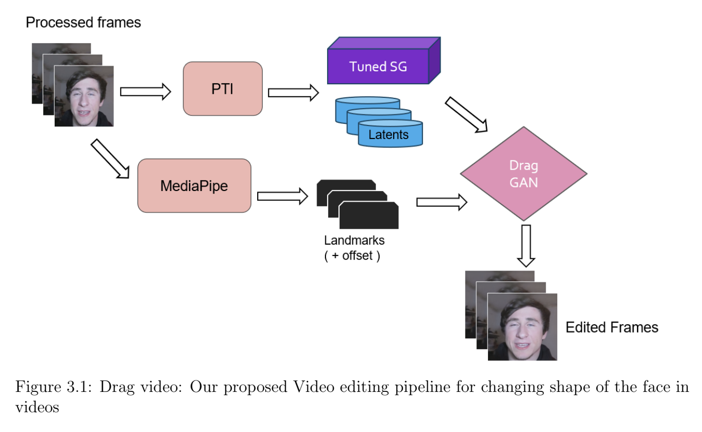

# About

This project aims to reshape human faces in videos, in a spatio-temporally consistent way.
- Motion supervision based latent code editing is performed in the latent space of styleGAN to create desired edits.

## network pipeline

## Preliminary Results

**Comparison Setup:**
* **Left:** Original video
* **Right:** Edited video

### Wider Face
Face transformed to be broader:

<video src="https://github.com/AshokBatakala/DragVideo/assets/111169763/afec5fd6-fc09-4bec-a0c5-402328c0c5e4" width="180" ></video>
<video src="https://github.com/AshokBatakala/DragVideo/assets/111169763/45488273-eda2-4e68-893b-d60fd97fa916" width="180" ></video>

### Narrow Face
Face transformed to be narrower:

<video src="https://github.com/AshokBatakala/DragVideo/assets/111169763/95f22684-01a4-417d-bd33-295502136adc" width="180"> </video>
